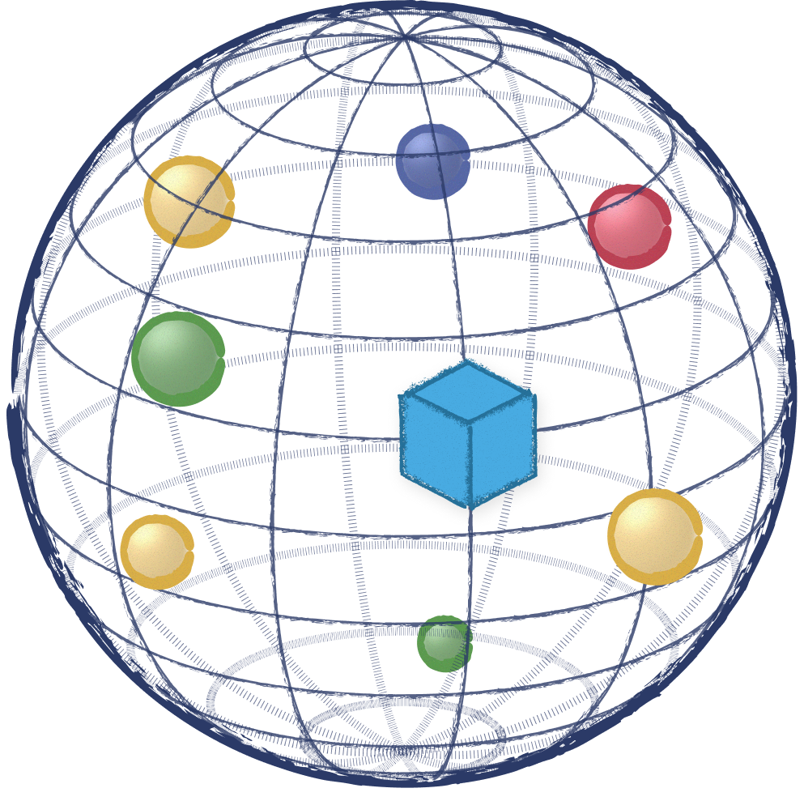
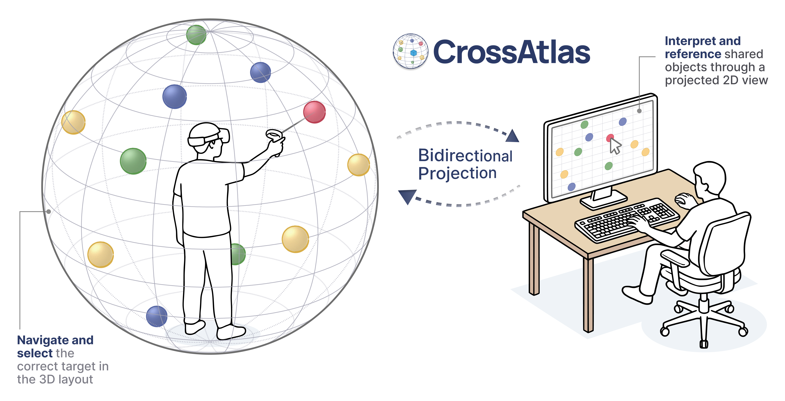
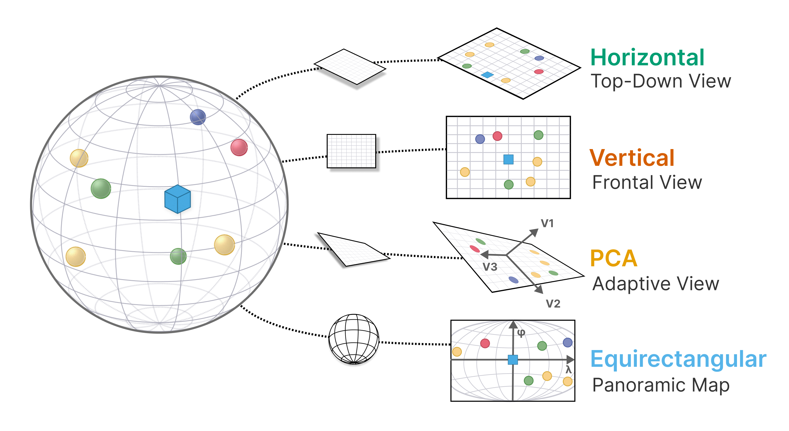

<h1>CrossAtlas <a href="https://doi.org/10.1109/TVCG.2026.3747485"></a></h1>

[](https://www.ieeeismar.net/2026/)
[](https://opensource.org/license/mit)
[](https://arxiv.org/abs/2607.28583)
[](https://doi.org/10.1109/TVCG.2026.3747485)

CrossAtlas is a <u>cross-reality collaboration platform</u> designed to help researchers study how **immersive 3D workspaces can be represented, shared, and referenced across devices** using <u>synchronized VR-PC views</u>, <u>bidirectional projection techniques</u>, and <u>shared spatial landmarks</u>.

<p align="center">
  
</p>

<table>
  <tr align="center">
    <td><a href="https://youtu.be/74zgdUXYGtw"><b>📺 Preview</b></a></td>
    <td><a href="https://youtu.be/zaG0kN3MoCw"><b>🎤 Paper Talk</b></a></td>
    <td><a href="https://doi.org/10.1109/TVCG.2026.3747485"><b>📖 Paper Link</b></a></td>
  </tr>
</table>

## Features

- 🧭 **Bidirectional Projection:** Four projection techniques (**Horizontal**, **Vertical**, **PCA**, **Equirectangular**) that transform the VR user's 3D layout into a 2D desktop view in real time, with inverse unprojection so desktop clicks map back into 3D space.
- 🔄 **Cross-View Synchronization:** Real-time state sync between VR and PC clients using **Yjs** CRDTs over WebSocket, keeping selections, task progression, and visual feedback consistent across both views with no perceptible delay.
- 🌐 **Configurable Spatial Layouts:** Parameterized layout curvature from flat front-facing arrangements to fully surrounding Full-Sphere configurations, with angular-distance-based point sampling relative to the VR user's headset.
- 🥽 **Browser-Based, Hardware-Agnostic:** VR client built with **Babylon.js** and **Anu.js** running in **WebXR**; PC client in **React**. 

## Projection Techniques

<p align="center">
  
</p>

CrossAtlas implements four bidirectional projection techniques across two families:

**Planar**

- **Horizontal** — Top-down (floor plane) view. Preserves lateral layout; collapses vertical structure.
- **Vertical** — Front-facing (wall plane) view. Preserves left-right and up-down; compresses depth.
- **PCA** — Adaptive plane maximizing point-cloud variance. Orientation is computed at task start; vertical gradient is used to establish a consistent "up."

**Spherical**

- **Equirectangular** — Maps each point to its angular position on a unit sphere around the VR user, then linearly maps longitude and latitude to a 2D rectangle. Provides a continuous 360° panoramic view of the full surrounding space.

For more details, please check out our [paper](https://doi.org/10.1109/TVCG.2026.3747485).

## Repository Structure

```
cross-atlas/
├── packages/
│   ├── client-2d/      # PC (2D) client — React + D3, Vite
│   ├── client-3d/      # VR (3D) client — Babylon.js + Anu.js + WebXR, Vite
│   └── shared/         # Shared task definitions, projection math, sync types, logging
├── scripts/
│   ├── dev.mjs                     # Orchestrates full dev stack
│   ├── yws-ssl-server.mjs          # Yjs WebSocket server
│   ├── generate-certs.mjs          # Self-signed SSL cert generation
│   └── generate-point-configs.ts   # Precomputed point selection generator
├── data/
│   └── point-selections.json       # Precomputed angular-distance point selections
└── certs/                          # SSL certificates (not committed)
```

## Quick Start

### 1. Clone the Repository

```sh
git clone https://github.com/AlexanderHYang/cross-atlas.git
cd cross-atlas
```

### 2. Install Dependencies

```sh
npm install
```

### 3. Generate SSL Certificates

The dev server requires HTTPS for WebXR. On first run, certificates are generated automatically if OpenSSL is available:

```sh
npm run generate-certs
```

> Certificates are written to `certs/` and are not committed to version control.

### 4. Launch the Full Dev Stack

Start the Yjs WebSocket server and both Vite clients in one terminal:

```sh
npm run dev
```

This starts the Yjs server plus the 3D (VR) and 2D (PC) Vite dev servers. All logs stream in the same window. `Ctrl+C` stops everything.

- Open the **3D client** (e.g. `https://<your-ip>:5173`) in your VR headset's browser. Accept the self-signed certificate, then click the headset icon to enter immersive mode.
- Open the **2D client** (e.g. `https://<your-ip>:5174`) on a desktop browser.

### CLI Flags

| Flag                                                        | Description                                                                |
| ----------------------------------------------------------- | -------------------------------------------------------------------------- |
| `--projection=<equirectangular\|pca\|vertical\|horizontal>` | Set projection mode (default: client-selected)                             |
| `--layout=<spherical\|hemispherical\|planar>`               | Set point layout curvature                                                 |
| `--tasks=<digits>`                                          | Enable specific tasks, e.g. `--tasks=13` for Tasks 1 and 3                 |
| `--require-calibration-orientation=<true\|false>`           | Require VR user to face landmark during calibration                        |
| `--random-selection=<true\|false>`                          | Use randomized angular-distance sampling instead of precomputed selections |

## Credits

❤️ **CrossAtlas** is a collaborative project between [Georgia Tech](https://gatech.edu) and [JPMorgan Chase](https://github.com/jpmorganchase), created by [Alex Yang](https://alexanderyang.me), [Chenyang Zhang](https://www.chenyang.me), [Elliott H. Faa](https://www.linkedin.com/in/elliottfaa/), [Weijian Liu](https://www.linkedin.com/in/weijian-liu-77b643237/), [Lily Chisholm](https://www.linkedin.com/in/lilychisholm/), [Benjamin Lee](https://benjaminchlee.github.io), [David Saffo](https://dsaffo.dev), [Feiyu Lu](https://ericlu25.github.io), [Blair MacIntyre](https://blairmacintyre.me), and [Yalong Yang](https://ivi.cc.gatech.edu/pi.html).

💙 CrossAtlas builds on [WebXR](https://immersiveweb.dev/), [Babylon.js](https://www.babylonjs.com/), and [Anu.js](https://jpmorganchase.github.io/anu/) ([GitHub](https://github.com/jpmorganchase/anu)), an open-source immersive analytics toolkit by JPMorgan Chase. Real-time synchronization is powered by [Yjs](https://yjs.dev/).

## Citation

```bibtex
@article{yang2026crossatlas,
  author={Yang, Haoyang and Zhang, Chenyang and Faa, Elliott H. and Liu, Weijian and Chisholm, Lily Seika and Lee, Benjamin and Saffo, David and Lu, Feiyu and MacIntyre, Blair and Yang, Yalong},
  journal={IEEE Transactions on Visualization and Computer Graphics},
  title={{CrossAtlas}: Evaluating Projection Techniques for Spatial Referencing in Cross-Reality Collaboration},
  year={2026},
  pages={1--11},
  doi={10.1109/TVCG.2026.3747485},
  url={https://doi.org/10.1109/TVCG.2026.3747485}
}
```

## License

**CrossAtlas** is available under the MIT License. It uses [WebXR](https://immersiveweb.dev/) (W3C Software and Document License), [Babylon.js](https://www.babylonjs.com/) (Apache 2.0), [Anu.js](https://github.com/jpmorganchase/anu) (Apache 2.0), and [Yjs](https://yjs.dev/) (MIT).
