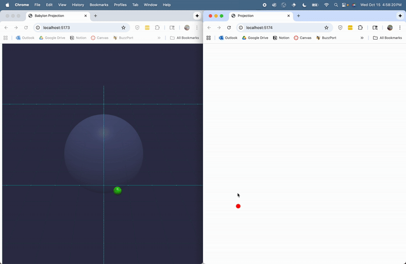

# Setup

1. Install dependencies:

> ```bash
> npm install
> ```

2. Launch the full dev stack (cert check → Yjs → 3D → 2D) in one terminal:

>```bash
>npm run dev
>```
>On first run the script generates self-signed certificates (requires OpenSSL), then starts the Yjs server plus both Vite dev servers. All logs stream in the same window, and `Ctrl+C` stops everything.

>Open the HTTPS URL printed by Vite (e.g. https://<your-ip>:5173) in your browser and accept the self-signed certificate.
>Open the HTTPS URL printed by Vite (e.g. https://<your-ip>:5174) in your browser.


3. Demo

>Place the two tabs side-by-side and drag the point around. Watch as the point is projected and bidirectionally synchronized.
>If your browser supports WebXR, use the Enter VR button in the 3D view to explore the scene immersively.
